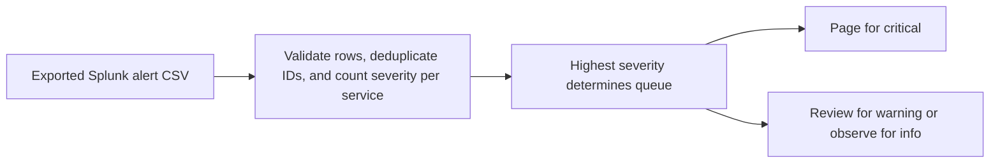

# Splunk Alert Triage

An exported alert stream can repeat events and bury the highest-severity service. Responders need a deduplicated queue for review.

## What I built

I built an offline triage CLI for exported Splunk alerts. It validates event ID, service, and severity, counts exact duplicates once, rejects conflicting duplicate IDs, and groups remaining events into page, review, or observe queues.

## How it works



[Architecture](docs/ARCHITECTURE.md) · [Decision rules and source](docs/RULES.md)

## Tools used

| Tool | Role in this repository |
| --- | --- |
| Python | [triage.py](triage.py) implements the CLI and decision rules. Uses `argparse` to parse command-line options, `collections` to group or count records, `csv` to read tabular exports, `json` to read or write structured records, `pathlib` to read local files. |
| Make | Runs the documented example and local checks. |
| Python replay runner | Compares actual stdout with the checked-in baseline fixtures. |
| Ruff and Bandit | Developer lint and static security checks through `make check`. |

## Run the project

Use Python 3.10+ and Make. From the repository root:

```sh
python3 triage.py example.csv
```

Checkout goes to page with one critical and one warning. Catalog goes to observe with one info event. [Full expected output](examples/Demo%201.stdout.txt)

### Additional replay cases

- **Last sample record in isolation** · `python3 triage.py examples/last-record.csv` · [Expected output](examples/Last%20sample%20record%20in%20isolation.stdout.txt)

## Verify the project

```sh
make verify
make replay
```

`make replay` checks the recorded cases and exits nonzero if the output changes.
See the [developer guide](docs/DEVELOPMENT.md) for the pinned lint and security tools.

## Operating limits

Use the CSV header event_id,service,severity in that order. Queue labels are recommendations. The tool does not connect to Splunk or send pages.

[Case study](docs/CASE_STUDY.md) · [Operator runbook](docs/RUNBOOK.md) · [Verification report](reports/verification.md)
