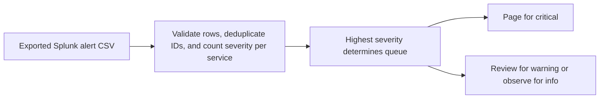

# Splunk Alert Triage

Turn exported alert rows into a prioritized on-call review queue. Exact duplicates count once. Conflicting event IDs fail the run.

## Quick start

With Python 3.10 or newer, run `python3 triage.py example.csv`. The synthetic sample places checkout in the page queue and catalog in observe.

## Input and limits

Export `event_id,service,severity` in that order. Normalize severity to `critical`, `warning`, or `info`. Critical services appear first, followed by warning count and service name. Queue names are recommendations. The CLI reads local files and makes no network calls. Live Splunk integration was outside the scope of this lab.

## Local verification

Run `make verify` with Make and Python 3 installed. The target runs the documented sample through the project CLI.

## Business problem

An exported alert stream can repeat events and bury the highest-severity service. Responders need a deduplicated queue for review.

## Project walkthrough



[Architecture and data flow](docs/ARCHITECTURE.md) · [Business problem, demo, and verification](docs/CASE_STUDY.md)

## Run the project

### Local setup

Run `make verify` with Python 3 and Make installed.

### CLI usage

```sh
python3 triage.py example.csv
```

### Replay usage

Run `make replay` to replay the checked-in inputs. The runner compares stdout with the baseline, reports differences, and exits nonzero on regression.

[Replay cases](examples/replay-manifest.json) · [Generated report](reports/replay.md) · [Rule implementation](docs/RULES.md)

### Run tests

[Verification report](reports/verification.md) · [Business problem, sample behavior, and limitations](docs/CASE_STUDY.md)


### Limitations

The verification report covers the bundled local examples. See the [case study](docs/CASE_STUDY.md) for project-specific assumptions and operating limits.
