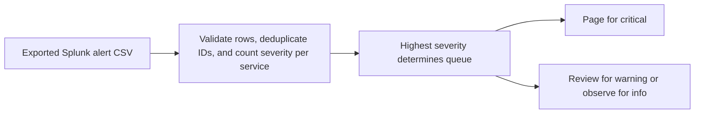

# Splunk Alert Triage architecture

Turn exported alert rows into a prioritized on-call review queue. Exact duplicates count once. Conflicting event IDs fail the run.

## Operational boundaries

The documented run evaluates the bundled sample locally. Results depend on the quality and scope of the input. The demo makes no live infrastructure changes.
